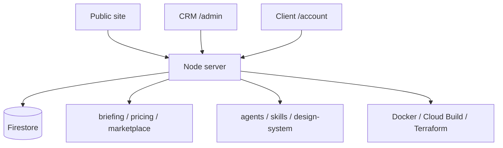

# CodeMatrix Agency

Technical base for CodeMatrix’s virtual agency platform — product site, CRM admin, client accounts, briefing/pricing engines, and design-agent contracts, aimed at Google Cloud Run.

## Problem / What it does

An agency needs a single platform for marketing, lead capture, client onboarding interviews, project state, staff CRM, and design-ops assets — without shipping full source publicly. CodeMatrix Agency is a Node.js service with Firestore persistence, admin CRM, client account area, adaptive briefing, pricing configuration, marketplace catalogs, and a large set of design-agent/skill contracts.

## Key features

- Containerized Node.js app with `/healthz` and `/ready`
- Firestore-backed persistence; Docker Compose for local runs
- Public landing, admin CRM (`/admin`: funnel, history, reports, CSV export)
- Admin auth via temporary email codes (passwordless)
- Client accounts (`/account`) with Firebase Authentication / Identity Platform concepts, org/project persistence, and Client/Staff/Administrator RBAC
- Adaptive discovery interview (one question at a time, skip/resume, autosave) advancing a project state machine toward preview readiness
- Payment confirmation workflow (client declares method and uploads a receipt; staff confirms/rejects) — automatic checkout path exists but is intentionally dormant by default
- Briefing engine (quick/full/workshop modes), pricing engine, and private Capability Marketplace (catalogs, toolkits, licenses/entitlements)
- Design-system tokens/themes/i18n foundations; contracts for ~20 specialized agents and ~25 design skills; MCP integration contracts
- Cloud Build pipelines and Terraform for Cloud Run + HTTPS load balancer posture
- Automated tests (`node --test`) and design validation script

## Tech stack

- **Runtime:** Node.js 22+
- **App:** JavaScript (ESM), custom HTTP server (`src/server.js`)
- **Data:** `@google-cloud/firestore`
- **Auth / cloud (evidenced in docs & structure):** Firebase Auth / Identity Platform concepts, Google Cloud Storage for receipt objects, Cloud Build, Terraform, Docker
- **Quality:** Node test runner, design validation script

## Architecture overview

Top-level areas: `src/`, `test/`, `infra/`, `agents/`, `skills/`, `mcps/`, `design-system/`, `briefing/`, `pricing/`, `marketplace/`, `docs/`.

## My role

Built for CodeMatrix (Anderson Henrique Gonçalves’ consulting company).

## Status

In development / MVP-oriented — substantial product surface and docs are present; README describes deliberate incremental expansion of AI/business engines.

## Source code

Source code is private. Available for walkthrough on request.

- LinkedIn: https://www.linkedin.com/in/andersonhenriquegoncalves
- GitHub: https://github.com/anderzilla
